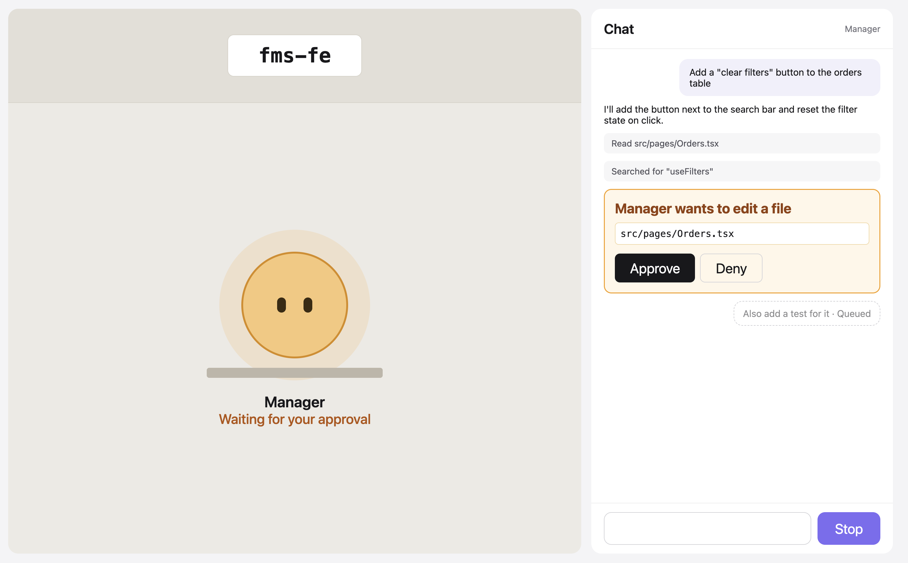

# MVP design brief

The look for every MVP screen, decided before step 10. Structure comes from [layout.png](layout.png); the base look from [mvp-direction.png](mvp-direction.png); product truth from [PRODUCT.md](../../PRODUCT.md). This is a brief: intent, rules and starting values, not code. Once built, the tokens and rules move into `DESIGN.md`.

## 1. Direction

**Base: the wireframe at full craft.** A calm, light, familiar chat-tool layout. The craft bar is **Claude.ai / ChatGPT** for the chat (message rhythm, streaming, the input) and **Linear** for rows, states and precision (aligned edges, quiet chrome, crisp feedback). They set the finish level, not the look.

**Four disciplines on top** (from the Pictogram Program world):

1. **Color only reports state.** Ink and neutrals for everything else, including buttons, links, focus and the Stop control. The five state colors appear only where they say what an agent is doing: the blob, its bubble, its label, the pending permission card, error rows.
2. **The blob alone owns the room.** The office is a plain room with the project plaque, one desk and the blob. No plants, no decor, no extra panels.
3. **Waiting takes the stage.** While a request is pending, the permission card and the blob are full strength, and the rest of the chat history steps back. The input stays fully usable.
4. **One right edge.** Every status and action in the chat sits right-aligned to the same edge: tool-line outcomes, Queued / Cancel, Cancelled, Approve / Deny.

**The blob stays a character:** round body, two eyes, at a desk. It isn't a pictogram. Pictogram's idea survives at small scale: each state has its own **glyph** in the blob's bubble, plus a **label**, so no state depends on color.

**Where the effort goes:** the chat panel, the state system and the tokens. These survive the 3D office. The office itself stays deliberately simple, because it will be replaced.

*Base direction before the four disciplines were applied; where this image and the brief differ, the brief wins.*

## 2. Tokens (roles, with starting values)

Values are starting points for the build. The roles and the rules are fixed.

**Neutrals**

| Role | Start | Used for |
| --- | --- | --- |
| `bg` | `#F4F4F6` | App ground, the gap between panels |
| `surface` | `#FFFFFF` | Chat panel, start card, input |
| `surface-sunken` | `#F6F6F7` | Tool lines, code/command boxes |
| `office-ground` | `#ECEAE4` | Office floor (a neutral with a slight warmth, not a color) |
| `office-wall` | `#E2DFD7` | Office wall band |
| `desk` | `#BDB6A8` | Desk |
| `text` | `#18181B` | Body text, primary buttons |
| `text-muted` | `#52525B` | Secondary text, tool targets |
| `text-faint` | `#A1A1AA` | Placeholders, stepped-back history |
| `line` | `#E4E4E7` | Dividers, outlines |

**States.** Each state has three tokens: `body` (blob fill), `strong` (text and rings on white, ≥ 4.5:1) and `soft` (tinted backgrounds).

| State | body | strong | soft |
| --- | --- | --- | --- |
| `idle` | `#B4A9F8` | `#5E4AD6` | `#F1EEFE` |
| `thinking` | `#8E7DF6` | `#4B36D1` | `#ECE8FE` |
| `working` | `#4CB676` | `#1E7543` | `#E6F5EC` |
| `waiting` | `#F5A524` | `#9A4A06` | `#FFF3DD` |
| `error` | `#E5484D` | `#B42318` | `#FDECEC` |

Idle and thinking share a hue (as vision.md says). They differ in saturation, glyph, label and motion.

**Type**
- The system UI stack (SF Pro on the Mac), so it feels at home next to Claude.ai and Linear. Mono: `ui-monospace` (SF Mono) for paths, commands and the project plaque.
- Scale: 12 (meta), 13 (tool lines, labels), 15 (chat body, line height ~1.55), 17 (card titles, blob name), 22 (start-screen title), 28 (project plaque).
- Weights: 400 and 600 only.

**Shape and space**
- 4px spacing scale.
- Radii: 8 for rows and tool lines, 12 for cards, the input and buttons, 16 for panels. The blob and its bubble are circles.
- No shadows, except the waiting ring (below).

**Focus.** A 2px `text` outline with a 2px offset on every control. Ink, not a color.

## 3. The state system

One definition, used by the office, the compact strip (§5) and later the 3D renderer: state → body color, glyph, label, eyes, motion.

| State | Glyph in bubble | Label under name (plain) | Eyes | Motion | Reduced motion |
| --- | --- | --- | --- | --- | --- |
| `idle` | **z** | "Ready when you are" | Forward, blink every ~6 s | Slow breathing (~4 s, tiny scale) | Still; no blink |
| `thinking` | **…** (three dots) | "Thinking" | Glancing up | Faster breathing (~1.6 s); dots step in turn | Still; dots static |
| `working` | **wrench** | The activity, e.g. "Editing App.tsx", "Running python3" | Looking down at the desk | Small bounce (~0.6 s) | Still |
| `waiting` | **!** | "Waiting for your approval" | Looking toward the chat | Pulsing amber ring around the blob; bubble bobs | Steady ring at full strength; no pulse |
| `error` | **×** | "Something went wrong" | Eyes become small × marks | One short shake on entering, then still | No shake |

- **Glyphs** are drawn as SVG on one 16px grid with one stroke weight, so they read as a set. The bubble is the same shape in every state. Its fill is the state's `soft` tone with the glyph in `strong`, except in **waiting**, where the bubble is larger and filled with the `body` amber. Waiting is the only filled bubble, and the most noticeable state.
- **Without color, every state still differs by glyph + label + eyes** (+ motion when allowed).
- **Changing state:** body and bubble crossfade (~200 ms); the label swaps without animation, so it is never mid-change when glanced at.
- **Announcements:** the office label is an `aria-live="polite"` region ("Manager: waiting for your approval").
- **Voice:** the idle label is the only playful line ("Ready when you are"). Every other label is plain.

## 4. Screens

### Start screen
- A centered card, as in the wireframe: the blob face (idle, the only color on the screen), **Agent Office**, then "Which project should the agents work in?"
- The path input is prefilled with `~/`, with the cursor at the end, followed by an **Open** button (ink).
- Below: "Tip: you can type ~ for your home folder" (muted).
- **Invalid path:** an inline line in `error.strong` under the input, with the × glyph: "That folder doesn't exist. Check the path and try again." (or the backend's reason). The input keeps its text and gets focus back.
- **Config invalid** (`PROJECT_DIR` set but bad): a notice above the input in the card, with an `error.soft` background, × glyph and plain text: "The project folder set in the backend config isn't valid: <reason>". The input still works.
- **Opening:** the button reads "Opening…" and is disabled. No spinner on the page.
- **Backend unreachable:** "Can't reach the backend. Is it running? Retrying…" in muted text under the card.
- Enter submits. Plain register throughout; no jokes.

### Main screen
- **Office:**
  - a wall band at the top holding a white plaque with "PROJECT" (12, muted caps) and the name (28, mono). A long name truncates with an ellipsis; the full name is in a tooltip.
  - the floor below it, with one desk and the blob centered on the floor. At full width the blob is ~150px, with the bubble above-right and the name and label below the desk.
  - nothing else in the room (discipline 2).
- **Chat:** a white panel with a header ("Chat", and "Manager" right-aligned in muted text), the message list, and the input bar pinned to the bottom.
- **Panels:** separate surfaces with radius 16 on the `bg` ground, with a 12–16px gap.

## 5. Widths

**Full window is the primary layout.** Agent Office is meant to be used full screen as my main workspace (PRODUCT.md, Operating Context). Design, review and screenshots start at full width (e.g. 1440–1728px on the MacBook, wider on an external display); the narrower layouts are supported fallbacks that must still work, not the main case.

| Window width | Layout |
| --- | --- |
| ≥ 1200px (full window, **primary**) | Office \| chat at **480px** fixed. Blob ~150px. The office takes all remaining width and stays centered, however wide the window. |
| 760–1199px (fallback: half-screen split or side window) | Office \| chat at **400–440px**. Office min 320px; the blob scales down (~110px); the label stays readable at 13px. |
| < 760px (fallback: narrow side window) | The office collapses to a **compact strip** at the top of the chat column (~72px tall). It holds a mini blob (40px) with its glyph bubble, "Manager", the state label, and the project name on the right in muted mono. The chat fills the rest. |

- The compact strip is the office at small scale, not a second state system: same tokens, glyphs, labels and eyes. In waiting, the strip gets the `waiting.soft` background and the steady amber ring, so it reads from the corner of the eye.
- It reads only `project` and `agents` from the store, like the office. When the 3D office arrives, the strip can stay 2D.
- Height: the chat list scrolls and the input never leaves the screen. The office content stays centered; nothing scrolls in the office.

## 6. Chat panel parts

**Message rhythm** (Claude.ai bar)
- Assistant text is plain, full width, no bubble, 15px. My messages are right-aligned bubbles (`surface-sunken`, radius 12, max ~80% width).
- Streaming text appears in place, with no cursor animation and no layout jump.
- **Markdown, minimal set:** paragraphs, lists, inline code and code blocks (mono, `surface-sunken`, radius 8, horizontal scroll, no syntax colors). Everything else shows as plain text.
  - **Never render raw HTML** from agent output: it can contain content from files the agent read. HTML in the text shows as literal text.
  - Links open in a new tab with `rel="noopener noreferrer"`, or show as plain text if that's simpler.
- Auto-scroll follows the stream only while I'm at the bottom. If I've scrolled up, a "Jump to latest" pill appears instead of yanking me down.

**Tool lines** (Linear bar)
- One line each, `surface-sunken`, radius 8, 13px. The plain tool name in `text` ("Edit src/App.tsx", "Bash npm test"), not a past-tense verb, because the backend doesn't track results yet. Then the target in mono `text-muted`, truncated with an ellipsis; the full value is in a tooltip.
- **Right edge:** the outcome only when there was a permission request: "Approved", "Denied", "Timed out", "Cancelled" (12, muted). Auto-allowed reads show nothing there.
- **Outside the project:** its own label line under the tool line: a warning icon + "Outside the project:" + the path, e.g. "⚠ Outside the project: ~/.claude/settings.json". `text` at 600 weight, with the path in mono. It's a safety signal, so it never relies on weight alone, and it never uses a state color (it isn't an agent state).
- Never raw JSON.

**Permission card** (the most important control in the app)
- **Pending:**
  - `waiting.soft` background, 1.5px `waiting.body` border, radius 12, and a soft amber ring around it (the only "shadow" in the app);
  - title, plain and by tool: "Edit a file", "Write a file", "Run a command";
  - the SDK's short label under the title, if present;
  - a mono box (`surface`, line border) with the path or the **full command**: every line, wrapped, never cut. Past ~12 lines the box scrolls inside itself with a visible scrollbar;
  - when it applies, the outside-project label line directly under the box, in the same form as on tool lines: "⚠ Outside the project: ~/.claude/…". This is the moment of decision, so the icon and the explicit wording are both required;
  - **Approve** (ink, filled) and **Deny** (outline), right-aligned to the one edge.
- **Never auto-focused.** Approve must not catch an Enter meant for the input. Both buttons are reachable by Tab.
- **Resolved:** the card collapses to a compact row in the timeline, e.g. "Edit · src/pages/Orders.tsx", with the outcome at the right edge (Approved / Denied / Timed out / Cancelled). There are no buttons, and the amber goes away, since the state is over.
- **Several pending:** each gets its own card, in order. The agent stays waiting until all are answered.

**Waiting takes the stage** (discipline 3)
- While any card is pending, all chat history other than the pending card(s) steps back: text to `text-faint`, tool lines to ~60% opacity. The fade is ~150 ms, and instant with reduced motion.
- The office blob is in waiting at full strength. The input and the Stop button are **not** dimmed.
- Everything returns when the last card resolves.

**Queued messages**
- A right-aligned bubble, dimmed (~55% opacity), with a dashed `line` outline instead of a fill.
- Under it, right-aligned: "Queued" (12, muted) and a **Cancel** text button.
- They always sit at the bottom of the list, after the streaming reply, in send order.
- **Delivered:** the bubble moves to the end of the timeline and fades to a normal message (~150 ms).
- **Cancelled:** the bubble stays in the timeline at the point I cancelled it, muted, with "Cancelled" at the right edge. No strikethrough, so it stays readable.
- **Esc** cancels the last queued message. With nothing queued and the agent busy, Esc is **Stop** (same as the button). When idle, it does nothing. It works with focus in the chat input or on no field, never while typing in another field.

**Thinking indicator**
- At the very bottom of the list (after queued messages), while the agent is `thinking` or `working`. Hidden while `waiting` (the card is the focus then) and when idle.
- Line 1: a playful word, picked at random once per turn from our own hardcoded list (~20, e.g. "Pondering", "Noodling", "Tinkering"), three dots that step in turn, and the turn's elapsed seconds: "Pondering... · 12s". 13px, `text-muted`. The word is the office's light register leaking into the chat; it never appears on anything that asks for a decision.
- Line 2: the agent's current activity from `agent_state` (e.g. "editing App.tsx"), when present. 13px, `text-faint`, one line, truncated.
- A turn starts when the agent becomes busy, or when a queued message is delivered (the backend goes straight into the next turn). No model calls, no tokens.
- Reduced motion: the dots stay static. Not an `aria-live` region (it would announce every second); the office label announces the state.

**Stopped line**
- A neutral timeline row: a small ■ glyph + "Stopped" in `text-muted`, 13px, left-aligned like a tool line but without the sunken background.
- No color: it isn't an error.

**Error rows**
- `error.soft` background, × glyph, the message in `error.strong`, plain text. One per failure.

**Input bar**
- A textarea that grows to ~8 lines, then scrolls. Placeholder: "Message the manager…". Enter sends; Shift+Enter adds a newline.
- **Send button:** reads **Send** when the agent is free and **Queue** when it's busy. It's the same button with truthful wording; the message isn't lost, it waits.
- **Stop:** visible only while busy (thinking, working, waiting), to the left of Send. An outline button in ink with a ■ glyph and "Stop". It isn't colored and isn't red: it's a control, not a state. Clicking it needs no confirmation; the stopped line and idle are the feedback.
- **Disconnected:** a thin neutral bar at the top of the chat: "Reconnecting…". The input stays editable; sending is disabled until the connection is back.

**Empty chat:** "Ask the manager anything about fms-fe." in muted text, centered in the list. Plain register, because it's in the chat.

## 7. Boundaries

- **Light theme only** for the MVP. The tokens are roles, so a dark theme can be added later without touching components.
- **No sounds and no notifications.** Background-tab call-backs (title, favicon badge, notification) come later. The state lives in the store, so they can be derived from it without changing any UI here.
- **The office renderer reads only `project` and `agents`.** Glyphs, labels and state tokens live outside it, in a shared state-system module, so the 3D renderer reuses them for its overlays.
- **Not built:** decor, extra agents, the @ input, the preview window, the usage bar, the model dropdown, diff previews.
- **Anti-goals:**
  - color as decoration;
  - a purple or red Stop button;
  - auto-focused Approve;
  - a cut-off command on a card;
  - a cute message in a card or error;
  - an office busier than the blob.
  - raw HTML rendered from agent output;
  - an outside-project warning shown by weight or color alone.

## 8. Decided (were open)

1. **Markdown:** the minimal set (paragraphs, lists, inline code, code blocks), never raw HTML, and links as new tabs with `rel="noopener noreferrer"` or as plain text. See §6.
2. **Tool lines:** the plain tool name ("Edit src/App.tsx"), until the backend tracks results. See §6.
3. **Outside the project:** a warning icon and an explicit label line with the path, never bold alone and never a state color. See §6.
