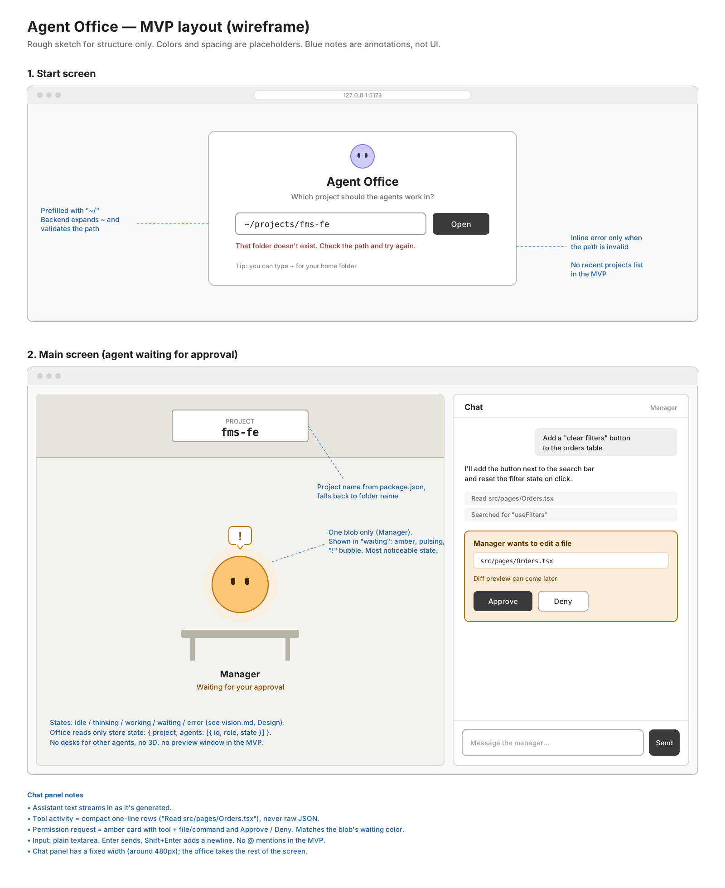

# Agent Office: Vision

The long-term picture of the project. For what is being built right now, see the current plan in [`plans/`](plans/). Decisions and their reasoning live in [`decisions/`](decisions/).

## 1. What this is

A **local web app** that wraps Claude Code in a visual "office".

- **Left panel (office view):** the current project shown as an office. The project name is on the wall. Each agent is a character at a desk, with a role label. Characters animate according to what their agent is doing.
- **Right panel (chat):** I chat with the **manager** agent by default, or address a specific agent with `@name` (autocomplete, like slash commands in Claude Code).
- **Live preview (later):** the frontend agent can open a floating, draggable window with the project's dev server running inside an iframe, so I can try features and layouts without leaving the app.

It runs only on my machine (macOS). It is a personal tool, not a product.

## 2. Layout

```
+---------------------------------------------+----------------------+
|  [ fms-fe ]  <- project name on the wall    |  Chat                |
|                                             |                      |
|   (Manager)    (Frontend)    (QA)           |  me: add a filter    |
|    desk          desk         desk          |  manager: on it...   |
|    idle        typing...     waiting!       |  [Approve] [Deny]    |
|                                             |                      |
|        +-------- floating preview --------+ |                      |
|        |  localhost:5173 (iframe)         | |  > @fro|             |
|        +----------------------------------+ |    @frontend         |
+---------------------------------------------+----------------------+
```



## 3. Architecture

```
Browser (React UI)  <--WebSocket-->  Node backend  -->  Claude Agent SDK  -->  project folder
```

- The **backend** owns everything that touches the machine: running Agent SDK sessions, the file system, spawning the dev server.
- The backend streams SDK events (messages, tool calls, permission requests, results) to the browser over a WebSocket.
- The **frontend** never talks to Claude directly. It renders events as chat messages and character states, and sends my messages and approve/deny decisions back.

### Rule: the office renderer is swappable

The office view only reads plain state from the store, for example:

```ts
project: { name: "fms-fe" }
agents: [{ id: "manager", role: "Manager", state: "waiting" }]
```

The renderer draws that data and nothing else. It never talks to the WebSocket or the backend, and holds no logic about what an event means. Turning SDK events into agent states happens outside the renderer.

This is what lets the MVP renderer (CSS blobs) be replaced later by a 3D renderer without changing the backend, the chat, or the store. See [decision 004](decisions/004-swappable-office-renderer.md).

## 4. Tech stack

| Part | Choice |
| --- | --- |
| Frontend | React + Vite + TypeScript |
| State | Zustand |
| Styling | Tailwind CSS v4, design tokens in its theme (see [decision 011](decisions/011-tailwind-styling.md)) |
| Office view (MVP) | Plain DOM + CSS "blobs" (see [Design](#8-design)) |
| Office view (later) | React Three Fiber + drei, 3D with orbit, pan and zoom |
| Chat `@` mentions | Tiptap Mention extension (later; plain textarea for MVP) |
| Floating preview | `<iframe>` inside react-rnd (later) |
| Backend | Node + TypeScript, Express with `ws` on the same HTTP server (see [decision 007](decisions/007-express-over-hono.md)) |
| Agent engine | `@anthropic-ai/claude-agent-sdk` (TypeScript) |

## 5. Authentication (required)

The backend **must** run on my Claude subscription through an OAuth token. See [decision 002](decisions/002-oauth-token-required.md).

- `CLAUDE_CODE_OAUTH_TOKEN` lives in `backend/.env` (generated with `claude setup-token`). `.env` is gitignored.
- On startup, if `CLAUDE_CODE_OAUTH_TOKEN` is missing, the backend exits with a clear error message. No fallback to other credentials.
- On startup, **remove `ANTHROPIC_API_KEY`, `ANTHROPIC_AUTH_TOKEN`, `CLAUDE_CODE_USE_BEDROCK`, `CLAUDE_CODE_USE_VERTEX` and `CLAUDE_CODE_USE_FOUNDRY` from the environment** before any SDK call. They take precedence over the OAuth token and would silently switch billing away from the subscription. Log a warning naming each one that was present, never its value.
- `apiKeyHelper` (a settings entry) also outranks the token. It can't load because the session doesn't read user or local settings (see [decision 009](decisions/009-streaming-input-session.md)).
- The token never goes to the frontend: no `VITE_` variable, no API response, no logs.
- How we know it's the subscription: a garbage token fails with `401 Invalid bearer token` (no fallback to the Mac's Claude Code login), and a real run emits `rate_limit_event` with `five_hour` / `seven_day` utilization, which are subscription limits. The init message's `apiKeySource` reports `none` for the OAuth token, so it is **not** proof of anything. See [sdk-events-sample.md](notes/sdk-events-sample.md).
- Optional `MODEL` in `backend/.env` sets the main model (alias or full ID). Unset means the account default; the backend logs the model the init message reports. Claude Code also uses a small background model (seen as `claude-haiku-5-5` in `modelUsage`) that `MODEL` doesn't control.

## 6. Project directory selection

- On startup the UI asks for a project directory, prefilled with `~/`, and shows recent projects.
- The frontend sends the path **string** to the backend. The backend:
  1. expands `~` with `os.homedir()`
  2. refuses anything else that isn't absolute (400 "Use a full path, or start with ~."); relative paths are never resolved against the backend's folder or home
  3. normalizes with `path.resolve()`
  4. checks it exists and is a directory
  5. uses the absolute path as the SDK session's `cwd`
- Only absolute paths are stored. Recent projects go in `~/.agent-office/config.json`, never in the repo.
- Paths are built with Node's `path` module, never by concatenating `/`.
- The project name shown on the wall comes from `package.json` `name`, falling back to the folder name.
- Optional CLI start: `agent-office [dir]`, defaulting to `process.cwd()`.
- Optional `PROJECT_DIR` in `backend/.env` (config, not a secret), validated the same way:
  - not set: the start screen asks for a folder
  - set and valid: opened on startup, start screen skipped, and the instance is pinned (no switching in the UI)
  - set but invalid: the backend still starts, and the start screen shows "The project folder set in the backend config isn't valid: <reason>" with a working path input
- One project per backend instance. Several projects at once means several instances, each with its own `PORT` (backend, default 3001) and `WEB_PORT` (frontend, default 5173). See [decision 010](decisions/010-one-project-per-instance.md).

## 7. Security

- The backend can run shell commands, so it binds to **`127.0.0.1` only**.
- Binding to `127.0.0.1` doesn't stop a web page open in my browser from connecting to it (WebSockets have no CORS). The WebSocket upgrade and `POST /api/project` are refused unless `Origin` is `http://127.0.0.1:${WEB_PORT}` or `http://localhost:${WEB_PORT}`.
- Every file edit and every command that isn't read-only asks for approval in chat. File reads inside the project and read-only commands (`ls`, `git status`) run without asking; that's how the SDK's `default` permission mode works. No auto-approve in the MVP.
- The session loads only the project's own settings (`settingSources: ["project"]`), so allow rules from `~/.claude/settings.json` and `.claude/settings.local.json` don't apply. Allow rules committed in the project's `.claude/settings.json` are honored; the backend logs them when the project opens.
- Never use the SDK's `allowedTools` option: it auto-approves tools and bypasses the approve/deny cards. Tools are restricted with `tools` instead.
- Auto-memory is off for agent sessions. Its writes into `~/.claude/projects/<encoded-cwd>/memory/` skipped the approve card, and Claude Code auto-approves that folder even with memory off. So a flag-settings `ask` rule (`Edit(~/.claude/**)`) sends every write under `~/.claude` to the card. The memory folder is keyed by the git repo (or the folder outside a repo) and shared with Claude Code CLI sessions there. See [decision 009](decisions/009-streaming-input-session.md); `backend/spike/write-probe.ts` checks this after SDK upgrades.
- Session transcripts still go to `~/.claude/projects/<encoded-cwd>/`, regardless of `settingSources`. That's the SDK's own write, not a tool call.
- Tool lines and approve cards never show `../` chains. A path outside the project shows as `~/…` (or absolute) with `outsideProject: true`, so the UI can warn.

### Pending permission requests

See [decision 008](decisions/008-pending-permissions-survive-reload.md).

- The backend keeps pending requests keyed by id.
- On every WebSocket connect, the backend sends a state snapshot including any pending request, so the approve card reappears and the blob returns to `waiting`.
- If nobody answers within 10 minutes, the request is denied and the agent is told it timed out (`PERMISSION_TIMEOUT_MS` shortens this for testing).
- Opening another project, or the query failing, cancels pending requests (`permission_resolved` "cancelled").
- Only the first answer counts: a second one (two windows both clicking) or one for an unknown request is ignored and logged.
- `options.suggestions` is never applied.
- Never auto-approve.

## 8. Design

Images go in `docs/design/`. Notes here describe intent; the images are the source of truth for the look.

- [`docs/design/layout.png`](design/layout.png): rough wireframe of the start screen and the two-panel layout. **The only image the MVP needs.**
- [`docs/design/future/`](design/future/): references for the long-term 3D office. **Not MVP. Do not build from these until a plan file says so.**

### Characters (MVP: blobs)

A "blob" is the simplest possible character: a `<div>` with `border-radius: 50%`, two small divs as eyes, a name and role label underneath, and one CSS class per state that sets its color and animation. No images or assets.

| State | When | Look |
| --- | --- | --- |
| `idle` | Nothing running and nothing queued, or I pressed Stop (and sent nothing after it). A turn that ends with messages queued goes straight to `thinking` for the next one, never through `idle` | Soft purple, slow breathing |
| `thinking` | Agent is reasoning or writing text | Purple, faster breathing, "..." bubble |
| `working` | Agent is editing a file or running a command | Green, bouncing, bubble with a short label (e.g. "editing App.tsx") |
| `waiting` | Agent needs my approval or input | Amber, pulsing, "!" bubble. **Must be the most noticeable state.** |
| `error` | Something failed. Stays until my next message, which moves it to `thinking` | Red, shaking |

Colors and animations can change; the states and "waiting is the most noticeable" can't.

### Office

- MVP: a simple flat area with the project name on the wall at the top and one desk (a plain bar under the blob) per agent.
- Long-term direction: a **3D office** with orbit, pan and zoom, built with React Three Fiber. Start with primitives (box room, box desks, capsule agents that bob or glow per state), then nicer models and animations. A 2D pixel-art phase is **not** planned. See [decision 003](decisions/003-blobs-first-3d-later.md).

### Chat panel

- Message list with streaming assistant text.
- Tool activity shown compactly (e.g. "Edited `src/App.tsx`"), not as raw JSON.
- Permission requests are cards with the tool, the command or file, and **Approve** / **Deny** buttons.
- Input at the bottom. Enter sends, Shift+Enter adds a newline.
- **Queued messages.** A message sent while the agent is busy is held in a backend queue, not pushed into the SDK yet. It shows in the chat as queued: dimmed, with a "Queued" mark. When the current turn ends (idle), the backend delivers the next queued message, and it shows as a normal message from then on.
  - Cancelling: each queued message has a cancel button. Esc cancels the last queued one; with nothing queued and the agent busy, Esc is Stop; when idle, it does nothing. Esc works in the chat input or with no field focused, not while typing in another field. Cancelled means it never reached the agent.
  - Queued messages survive a reconnect through the snapshot.
- **Stop.** A Stop control, visible only while the agent is busy (thinking, working or waiting), calls the query's `interrupt()`. Stop means stop everything:
  - it interrupts the current turn;
  - it marks every queued message cancelled;
  - it cancels any pending permission request (`permission_resolved` "cancelled").
  - The agent goes to `idle`.

## 9. Agents and roles

- **Manager** (default receiver): plans and delegates.
- Planned roles: Frontend engineer, Backend engineer, QA. Defined as subagents (name, description, prompt, allowed tools, model).
- App agent role definitions live in `backend/src/roles/`, **not** in `.claude/agents/` (that folder is for agents that help build this repo). See [decision 006](decisions/006-app-roles-not-in-dot-claude.md).
- Routing decision: `@agent` messages go **through the manager**, which delegates. Not separate sessions per agent. The UI still animates the specific agent that is active. See [decision 001](decisions/001-route-via-manager.md).

## 10. Repo structure

```
agent-office/
├── CLAUDE.md
├── README.md
├── .gitignore
├── .claude/
│   ├── settings.json
│   └── commands/
├── docs/
│   ├── vision.md
│   ├── design/
│   │   ├── layout.png
│   │   └── future/        3D references, not MVP
│   ├── plans/
│   │   ├── 001-mvp.md
│   │   └── 001-mvp-steps.md
│   ├── notes/
│   │   └── sdk-events-sample.md
│   └── decisions/
├── backend/
│   ├── .env               not committed
│   ├── .env.example
│   ├── spike/
│   │   └── sdk-spike.ts   manual SDK sanity check
│   └── src/
│       ├── index.ts
│       ├── project.ts
│       ├── session.ts
│       ├── ws.ts
│       └── roles/         later
├── frontend/
│   └── src/
│       ├── App.tsx
│       ├── store.ts
│       ├── ws.ts
│       ├── office/
│       └── chat/
└── shared/
    └── events.ts
```

The `src` file names are a suggested starting split, not a rule.

## 11. After the MVP (rough order)

1. Chat panel extras:
   - Subscription usage bar from `rate_limit_event` (`five_hour` / `seven_day` utilization).
   - Model dropdown, filled from `query.supportedModels()` and switched with `query.setModel()` (possible because the session uses streaming input). Like `MODEL`, it only controls the main model, not Claude Code's small background model.
2. Permission card previews: show the content for `Write` and the diff for `Edit`, so I can judge a change before approving it.
3. Multiple agents as subagents, one blob each, `@` mentions with autocomplete.
   - Per-agent models: each role in `backend/src/roles/` gets a `model` field (alias, full ID, or `'inherit'` = the main model).
   - After that, a settings UI to edit the per-agent models.
4. Dev server control and the floating preview iframe.
5. 3D office with React Three Fiber: primitives first (box room, desks, capsule agents), camera with orbit, pan and zoom.
6. Better project selection: folder browser, recent projects, and the `agent-office [dir]` CLI start (see [Project directory selection](#6-project-directory-selection)).
7. Nicer 3D models and animations, browsing past sessions, sounds, polish.
